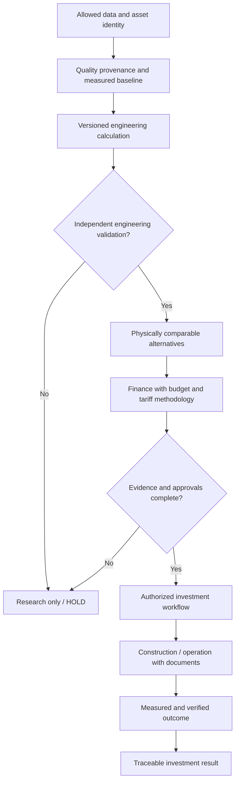

# ГИДРОКОНТУР 360 — МАГАДАН
## Инженерно-финансовое досье V7.3 (внутренняя версия)

**Дата версии:** 23 октября 2026 г. **Производственный статус:** HOLD. **Формат:** исследовательский серверный прототип; только искусственные входные данные. Ни одно действующее оборудование не подключено.

### 1. Предмет проекта и границы обязательств

Проект предназначен для подготовки воспроизводимых технических и экономических обоснований управленческих решений в гидроэнергетике, электрических и тепловых сетях, диагностике активов и капитальных инвестициях. Продукт не является системой технологического управления и не должен заменять диспетчеризацию, РЗА, АСУ ТП, системы бюджетирования или отраслевые инженерные комплексы без отдельной оценки заказчика.

Первоочередная прикладная география — Магаданская область: Колымский каскад ГЭС, сетевые и тепловые активы соответствующих организаций. Все перечисленные объекты — потенциальные площадки. Предмет пилота, правообладатель данных, инженерное заключение и коммерческое участие **не согласованы**. Нельзя использовать публичную карту или учебный расчёт как исполнительную схему действующей сети.

Две задачи программы нужно вести отдельно:

1. **Разработка общего продукта:** защищённая модель организаций и активов, достоверность данных, управляемые версии моделей, ограничения, сравнение альтернатив, инженерно-экономическое досье, аудиторский след, документы.
2. **Отраслевое доказательство:** юридически разрешённые производственные данные, применимые нормы, эталонная модель, самостоятельный инженерный расчёт, финансовая методика предприятия, согласование и послепроектная оценка.

Суммы бюджета из прошлых версий — сценарные допущения, не оферта «РусГидро» и не утверждённые капитальные затраты.

### 2. Что было и что реализовано в V7.3

| Блок | Было в V7.2 | Реализовано в V7.3 | Что ещё не доказано |
|---|---|---|---|
| GridLoss | Двухузловая симметричная AC-модель | Синтетическая радиальная сеть до 16 узлов и 48 временных окон (не более 192 узло-окон); ветвевые потери и напряжения | Многосвязная сеть, фазы, трансформаторы, АВР, независимый отраслевой эталон |
| Проверка расчётов | Аналитическое решение для двух узлов | Метод встречного/прямого обхода дерева + независимо инициализированный узловой расчёт KCL; сверка балансов | Экспертная приёмка реального объекта |
| Сравнение альтернатив | Совпадение текстового `scenario_group` | Фиксация идентичных нагрузок, напряжения, расчётных окон, структуры дерева и критериев напряжения | Корректность инженерных допущений на промышленном объекте |
| Финансовый эффект | Отдельная оценка HydroCAPEX | Досье, привязанное к двум конкретным запускам; перевод МВт·ч в кВт·ч и рубли; три ценовых сценария | Тарифное признание, затраты строительно-монтажных работ и подтверждённая экономия |
| Аудит | Сохранённые исследования, HMAC в лаборатории | Неизменяемые лабораторные досье с hash и версией финансовой модели, отдельный расчёт повторения | Нативный PostgreSQL 17, внешний архив WORM и корпоративные полномочия |
| Интерфейс | Шесть исследовательских модулей | Новая связанная рабочая область «радиальная сеть → экономика → досье» | Полная браузерная проверка с живым корпоративным API |

Запрещено считать результат `SYNTHETIC_RESEARCH_ONLY_NO_APPROVAL` утверждённым проектом или подтверждённым предотвращённым ущербом.

### 3. Физическая модель первой сетевой цепочки

**Топология.** Один питающий узел `SOURCE`, направленные ветви к потребителям, без циклов и несвязанных узлов. Каждый узел содержит `node_id`, `parent_id`, сопротивления `R`, `X` в омах на фазу, нагрузку `P` в МВт и `Q` в Мвар, допустимый ток `ampacity_a`. Все входы ограничены и проверяются.

**Режимы.** Каждое временное окно содержит коэффициент нагрузки и продолжительность в часах. Общая продолжительность не более 8784 часов. В лабораторной модели нагрузка масштабируется одинаково для всех узлов; в промышленной версии нужны фактические неоднородные графики.

**Вычисление.** Для симметричной схемы вычисляются токи ветвей и напряжения по комплексным уравнениям закона Кирхгофа, затем активные потери `P_loss = 3 Σ |I_k|² R_k`. Вторая, отдельно инициализированная система решает узловые уравнения KCL методом нелинейного корня. Если два решения расходятся сильнее программного порога, результат блокируется. Это независимость программных методов, не независимое заключение инженера.

**Физическая и нормативная допустимость различны.** Интерфейс сообщает о нарушениях заданных токовых и напряженческих ограничений. Порог 0,9 pu в примере — только искусственная инженерная гипотеза; он не является универсальным нормативным пределом Магаданской области.

**Не покрыто:** несимметричные трёхфазные сети, однофазные потребители, распределённая генерация, трансформаторы, ответвления, шунтовые элементы, изменение температуры проводников, N-1, РЗА, гармоники, повреждения, коммутация, качество электроэнергии, многосвязные сети. Подключение таких объектов к данному решателю запрещено по назначению.

### 4. Проверка сопоставимости двух вариантов

Для прямого финансового сравнения должны совпадать: юридическая организация, актив, группа исследования, справочное имя сети, входное напряжение, минимальное требование к напряжению, состав узлов, связи между узлами, распределение `P`/`Q`, последовательность временных окон, часы и масштаб нагрузки. В учебном варианте допускается изменение только сопротивлений ветвей и номинального тока.

Если отличается нагрузка, период либо топология, система возвращает `PHYSICAL_BASELINE_MISMATCH` и **не создаёт** финансового заключения. Альтернатива с нарушением заданных ограничений также не допускается к положительной экономической рекомендации (ограниченная лабораторная проверка).

Реальный проект, изменяющий топологию, может быть технически допустим — но для него потребуется отдельная, более сложная методика сопоставимого контрфактического сценария. Нынешний запрет не означает, что такие проекты нельзя строить; он ограничивает доказательную силу нашего лабораторного калькулятора.

### 5. Финансовая модель связанного сетевого мероприятия

`ΔE_window_MWh = E_base_MWh − E_alt_MWh`

`ΔE_year_kWh = ΔE_window_MWh × 1000 × annual_repeat_count`

`FCF_year = ΔE_year_kWh × value_RUB_per_kWh − annual_opex_delta_RUB`

`NPV = −CAPEX + Σ_{t=1..T} FCF_year/(1+r)^t`

**Критические проверки:** одно и то же исходное окно не может быть распространено на более чем 8784 часа; физические и ценовые предположения фиксируются; `low <= base <= high`; денежные величины считаются через `Decimal`, дублирующий код эффекта в одной организации отклоняется; отрицательный NPV отображается без искусственного улучшения.

Модель **не оценивает** обоснованность тарифа, компенсацию потерь, налоги, НДС, инфляцию, амортизацию, срок службы оборудования, ставку WACC «РусГидро», схему финансирования или реальную стоимость строительных работ. До получения этих данных нельзя переводить лабораторный NPV в бизнес-план магаданского объекта.

**Воспроизводимый пример V7.3:** базовые потери 2,399290916 МВт·ч; после условного изменения сопротивления 1,349564646 МВт·ч; за окно 1,04972627 МВт·ч. При искусственных 50 повторениях — около 52 486 кВт·ч в год. CAPEX 1,8 млн ₽; дополнительный OPEX 150 тыс. ₽/год; дисконт 12%; 8 лет. Получаются отрицательные NPV для заданных цен 2, 3 и 5 ₽/кВт·ч. Это **не данные сетевой организации и не российский тариф**.

### 6. Данные и информационная модель

Обязательная иерархия: `Organization -> Asset -> Source -> ModelVersion -> StudyRun -> ScenarioComparison -> EconomicDossier -> Outcome`. Для каждого хранятся идентификаторы, версии, организации, временные метки и контрольные суммы. Предметные выводы не могут появляться без соответствующих исходных записей. Результаты должны сохранять собственные единицы измерения.

`StudyRun` и `GridEconomicDossier` являются **исследовательскими**, не могут быть использованы как `CalculationRun` существующего инвестиционного workflow через прямое поле `run_id`. Межорганизационный доступ должен проверяться на сервере и после нативной миграции на RLS. Роль «economist» формирует денежную оценку; инженер не может выдать себя за экономиста через интерфейс.

Таблицы хранят документы и результаты в одной организации. Для действующей Группы потребуется дополнительно согласовать юридическую модель совместного анализа между разными собственниками объектов, лицензии на использование данных и полномочия одобрения.

### 7. Шесть промышленных продуктов: дальнейшая специализация

#### HydroForecast — Магаданская область и Колымский бассейн

**Объект и пользователи:** согласованный водосбор, гидрологи, аналитики планирования водных ресурсов. **Данные:** многолетние гидропосты, осадки, снегозапасы, температуры, границы бассейна, данные по водохранилищам, история официальных прогнозов и точное время появления наблюдений. **Алгоритмическое ядро:** физическая гидрологическая модель + контрольные статистические прогнозы, ансамбль, обработка пропусков и вероятностная калибровка. **Выход:** версия прогноза, диапазон неопределённости, ошибки, условия применимости. **Экономическая связь:** не прямое присвоение выручки, а проверяемая ценность информации в следующем производственно-экономическом расчёте. **Обязательная независимая проверка:** ретроспективные прогнозы без будущих данных и согласованный эталон. Никаких команд на гидросооружения.

#### CascadeEconomics — Колымская и Усть-Среднеканская ГЭС

**Данные:** характеристики и эксплуатационные ограничения, правила водопользования, гидрографические связи, задержки пробега волны, агрегатные характеристики и фактический прогноз притока. **Модели:** многопериодный водный баланс, допустимые объемы и расходы, характеристики агрегатов, запреты и обязательные экологические и иные ограничения. **Выход:** множество допустимых сценариев, выработка, неиспользуемый ресурс, чувствительность к водности и ремонтной готовности. **Приоритет развития:** физически верифицированное многопериодное моделирование вместо текущей одномоментной учебной модели с нулевой задержкой. Финансовая оценка не должна поощрять нарушение обязательных ограничений.

#### TurbineReliability — гидроагрегаты

**Данные:** заводские паспорта, ремонты, вибрационные/температурные и режимные сигналы, подтверждённые дефекты, снабжение и окна ремонта. **Модели:** отделение неисправных датчиков от эксплуатационного отклонения, контекст нагрузки, классы отказов, откалиброванный риск только при наличии подтвержденной истории. **Решения:** проверка, обследование, профилактика, ремонт, вариант закупки запасных частей. **Магаданское развитие:** стоимость и сроки доставки, северный календарь работ. **Запрет:** MAD-аномалия не является процентом вероятности отказа.

#### GridLoss Planner — распределительные сети Магаданской области

**Данные:** утверждённая электрическая схема, границы энергетического баланса, паспортные R/X, измерения с временными метками, счётчики, изменения топологии и тарифно-учетные механизмы. **Модели:** полноценный AC-расчёт выбранного участка, технические потери, неопределённость измерений и остаток баланса; различать инженерно рассчитанные потери и потери, выявленные по факту. **Решение:** допустимое мероприятие, проектные объёмы, смета и ROI. **Не утверждать:** весь разрыв баланса равен хищениям либо техническим потерям. **Внешний эталон:** pandapower и/или OpenDSS на идентичной разрешённой модели, инженерное заключение.

#### HeatNet Economics — тепловая генерация и теплоснабжение Магадана

**Данные:** исполнительные схемы, трубопроводы, изоляция, насосы, фактическая температура/давление/расход, регламент отопительного сезона и права отдельных организаций. **Модели:** теплогидравлические балансы, калибровка, реальные нагрузки, теплопотери. **Решение:** ремонт, реконструкция, насосное оборудование, финансовый и нефинансовый результат, социально значимые потребители. **Внешний эталон:** специализированный расчётный комплекс и данные эксперта; существующая формула `ṁ c_p ΔT` является лишь упрощённой лабораторией.

#### HydroCAPEX — инвестиционно-строительный контур

**Данные:** техническое основание, обязательность мероприятия, альтернативы, WBS/CBS, объёмы по изысканиям, BIM/проектная документация, логистика, договоры, фактические затраты, результаты после ввода. **Модель:** обязательные мероприятия не конкурируют с дискреционными только по NPV; учитываются зависимости, исключающие варианты и помесячные/годовые бюджетные лимиты, согласование. **Региональный компонент:** морозостойкость, геология/геокриология, логистические окна, стоимость мобилизации подрядчиков — исключительно при подтверждённой применимости. **Выход:** инженерно доказательное инвестиционное досье, а не вторая ERP.

### 8. Сквозные расчётные связи между продуктами

- HydroForecast выдаёт только проверенные прогнозные пакеты CascadeEconomics, включая информацию об неопределённости.
- TurbineReliability передает подтверждённый технический запрос на обследование или ремонт в HydroCAPEX; без экспертной оценки риск остается неопределённым.
- GridLoss передает технико-экономический вариант только после калибровки и проверки внешним отраслевым решателем.
- HeatNet передает документированные ремонтные и строительные альтернативы через общую структуру WBS/CBS.
- HydroCAPEX принимает уникальный экономический эффект, сохраняет способ расчёта и сверяет его с фактическими результатами, не удваивая эффект от разных модулей.
- Межорганизационные связи не предполагают бесконтрольного доступа к данным: обмен осуществляется по согласованным договорам и правилам.

**Принцип:** формально совпавший код эффекта не доказывает, что этот эффект вообще возник. Реестр результата отделяет `simulated`, `approved`, `executed`, `observed` и `verified`.

### 9. Конкурентное положение и инженерная совместимость

Реальные специализированные платформы уже содержат значительную долю функций, которые мы исследуем. OpenDSS применяет расчёты распределительных сетей и временных режимов; pandapower поддерживает AC/DC/трёхфазные режимы. Внешний расчётный комплекс должен быть эталоном, а не подменяться самопроверкой двух написанных нами численных алгоритмов.

**Источники:**
- PostgreSQL 17 RLS: https://www.postgresql.org/docs/17/ddl-rowsecurity.html
- pandapower Power Flow: https://pandapower.readthedocs.io/en/stable/powerflow.html
- EPRI OpenDSS: https://opendss.epri.com/PowerFlow.html
- IEC 61968-11 CIM: https://webstore.iec.ch/en/publication/6199

Наше позиционирование — связь инженерной модели, ограничения, варианта, инвестиционного решения и проверки результата; коммерческое превосходство над конкретным российским или зарубежным поставщиком **не доказано**.

### 10. Информационная безопасность и нормативный контур

Для PostgreSQL созданы миграции с FORCE ROW LEVEL SECURITY и разделением ролей, включая новую таблицу досье в `070_grid_economic_dossiers_v73.sql`. Однако **нативное исполнение PostgreSQL 17, RLS и конкурентных транзакций НЕ ПРОВОДИЛОСЬ**. Нельзя открывать промышленный доступ до самостоятельной приёмки этих механизмов.

OIDC-протокол имеет синтетические тесты; корпоративный провайдер идентификации не подключён. Внешний WORM-аудит не принят. Административная защита SQLite не является гарантией неизменяемого внешнего архива. Критически важно провести: тесты реальных JWT/SSO-ролей, отказ сессий, конкуренции переходов, секретов/сертификатов, восстановления БД, резервного копирования, отказов доставки событий и повреждения хранилища.

Для потенциальных строек требуется отдельная правовая матрица по ГрК РФ, ПП РФ №87 и №145, действующим техническим стандартам, безопасности ГТС и КИИ, водопользованию, экологии, земельным правам и охране труда. Применимость каждой нормы определяется для **конкретного объекта и вида работ**; данный документ не является юридической экспертизой.

### 11. Целевая архитектура и приёмка

**G0 — отраслевой заказчик и разрешение данных**: без прав на объект и подписанной технической методики исходные значения синтетические.

**G1 — модель данных**: паспорт, топология, наблюдения, версии, единицы и полнота.

**G2 — физический решатель**: независимый эталон, точность, устойчивость, корректный отказ при недопустимых вводах.

**G3 — экономический расчёт**: цены/сметы, сроки, налоговая/тарифная модель, согласованный контрфакт, независимое подтверждение.

**G4 — кибербезопасность**: PostgreSQL RLS на действительном движке, OIDC/MFA заказчика, аудит и тест восстановления.

**G5 — пилот**: подписанный акт с областью применимости, эффектом и перечисленными ограничениями.

**G6 — расширение**: решение об инвестициях, масштабирование и независимая проверка по каждому направлению.

### 12. Условия выпуска V7.3

Пакет является **лабораторным**. Разрешается: локальная установка, демонстрация на искусственных данных, проверка алгоритмов, просмотр результатов и подготовка независимого технического аудита. Запрещается: публиковать как промышленную платформу, использовать для изменения режимов энергетических объектов, подавать синтетический NPV как экономику Магаданской области и импортировать реальные данные без согласования.

На следующий этап необходимы нативный PostgreSQL 17, эталонный инженерный решатель, разрешённый сетевой фрагмент Магаданской области, методика финансовой оценки и внешний архив с подтверждёнными свойствами хранения. Переходить к утверждённым управленческим решениям до этих условий нельзя.
