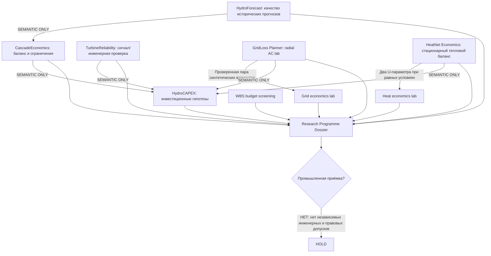

# ГИДРОКОНТУР 360 — МАГАДАН / V7.4: техническая архитектура

**Версия:** 7.4 LAB. **Дата:** 2026-10-23. **Технологический статус:** исследовательский; промышленное применение запрещено до отдельных разрешений и испытаний. **Инвестиционный статус:** гипотезы и синтетические примеры, не утверждённые проекты «РусГидро».

## 1. Архитектурный тезис

ГИДРОКОНТУР 360 не предназначен для замены АСУ ТП, корпоративной ERP, системы технического обслуживания или проектного САПР. Его предлагаемый продуктовый контур — прослеживаемое инженерно-экономическое исследование: источник → расчёт → физическая альтернатива → цена и бюджет → документ → решение → проверка результата. Группе компаний в Магаданской области могут принадлежать разные активы и данные; согласие одной компании не даёт доступа к сведениям другой.

### 1.1 Границы доверия

| Контур | Ответственность | Уже реализовано | Не реализовано / открытый допуск |
|---|---|---|---|
| Identity | Подтверждение пользователя | Argon2id/JWT лаборатории, OIDC PKCE/nonce по синтетическому IdP | Согласованное корпоративное SSO/MFA |
| Authorization | Права на объект, роль, организация | API-проверка членства; SQL-кандидаты RLS | Нативная PostgreSQL 17 RLS-приёмка |
| Asset Registry | Объект и правообладатель | LAB_REFERENCE / org_id, tenant FK | Подтверждённый реестр реальных активов и прав |
| Data Quality | Единицы, источники, момент доступности | Валидация Pydantic; синтетические source_ref; хеши | Реальные метрологические, юридические и предметные проверки |
| Calculation | Физические и статистические модели | Шесть ограниченных лабораторных моделей, многозвенная радиальная AC-модель | Нормативные модели гидрологии, тепло-гидравлики, сети; независимые эталоны |
| Programme Dossier | Связь моделей и зависимостей | Граф 5 типов, сохранённые источники, воспроизведение | Подтверждённые численные переходы между физическими областями |
| Financial Screening | CAPEX/OPEX, условные NPV и годовые бюджеты | GridLoss → финансы, HeatNet → финансы, WBS по годам | Фактические сметы, тарифы, налоги, капитал, причинная атрибуция эффекта |
| Decision | Раздельные инженерные/финансовые роли | Лабораторный процесс V7 и отдельный запрещённый к продвижению programme V7.4 | Экспертные подписи, корпоративный инвестиционный регламент |
| Audit | История и внешнее доказательство хранения | SQLite HMAC, проект PostgreSQL audit/outbox, тестовый HTTP-приёмник | Реальный WORM/retention, корпоративный независимый контроль |

### 1.2 Диаграмма предметных областей

## 2. Объектная модель и строгие связки

Обязательные ключи: `org_id` (юридически разграниченный периметр), `asset_id` (объект), `study_id` (неизменяемый расчёт), `engine_sha256` (версия кода), `source_ref` (синтетический источник), `scenario_group` (группа, а не доказательство физической эквивалентности), `dossier_id` (отдельное финансовое досье), `programme_id` (пакет исследований), `benefit_key` (метка гипотезы эффекта), `reference_code` (внутренний код программы).

Таблицы V7.4: `research_programmes`, `research_programme_studies`, `research_programme_finance`, `research_programme_links`. Дочерние записи имеют составные внешние ключи с `org_id`: невозможно ссылаться на расчёт другой организации при штатной записи. Новые записи лабораторно append-only. Табличная схема PostgreSQL находится в `080_research_programme_v74.sql`, **ещё не исполнена в PostgreSQL**.

Граф поддерживает только типизированные семантические связи: HydroForecast→Cascade, Cascade→CAPEX, Turbine→CAPEX, Grid→CAPEX, Heat→CAPEX. Направление и совпадение сценарной группы валидируются. Результат не конвертирует автоматически гидрологические значения в производственные, или индекс отклонения вибрации в вероятность отказа.

## 3. Понятие расчётной доказательности

**Calculated** означает: синтетические входы прошли структурную проверку, программа вычислила результат и сохранила контрольную сумму. **Reproduced** означает: доступен тот же исходный контент и та же версия алгоритма, результат совпал. **Validated externally** требует независимого расчёта на согласованном контрольном наборе и заключения инженера; сейчас НЕТ. **Approved for industrial decision** требует ещё правовых, эксплуатационных, производственных и финансовых разрешений; сейчас НЕТ.

`Programme Dossier` содержит блокирующие внутренние сообщения и отдельный неизменяемый перечень внешних ворот допуска. Никакой пользовательский флаг из синтетического запроса не может изменить `field_ready=false` и `eligible_for_industrial_approval=false`.

## 4. Технологическая модель по направлениям

| Модуль | Лабораторный математический объект | От чего зависит результат | Что нужно для промышленной верификации |
|---|---|---|---|
| HydroForecast | MAE, RMSE, bias, WAPE, покрытие интервала исторического hindcast | дата выпуска, дата доступности входов, точки прогноза | достоверные гидроряды, честные исторические прогнозы, гидрологические ансамбли, гидрологическая экспертиза |
| CascadeEconomics | Мгновенный баланс двух ёмкостей, условная энергия | расходы, уровни, напор, КПД, ограничения | гидравлическая связь, задержки, правила водопользования, энергохарактеристики, работа каскада |
| TurbineReliability | Медиана/MAD вибрации при сопоставимой нагрузке | датчики, режим нагрузки, история времени | дефекты и ремонта, экспертная разметка, режимные поправки, проверки ложных сигналов |
| GridLoss Planner | симметричный радиальный AC PQ, KCL/свип, напряжение и потери | топология, R/X, нагрузки, 48 окон max | актуальная однолинейная схема, баланс измерений, независимый PowerFactory/RastrWin/pandapower/OpenDSS эталон |
| HeatNet Economics | стационарное Q=m cp ΔT и U L ΔT | T, m, cp, L, U | гидравлика, реальные термограммы, поверка измерений, сезонность, калибровка ZuluThermo/аналога |
| HydroCAPEX | ограниченный набор бюджетных альтернатив до 12 проектов | стоимости, обязательность, зависимости, денежные гипотезы | техпроекты, корпоративные сметы, тип финансирования, инвестветирование, нормативные ограничения |

## 5. Обновлённая стройка и экономика

V7.4 WBS: код, категория, наименование, объём, единица, цена, год, зависимости, источник, резерв. Все источники строго `SYNTHETIC-...`; курс/инфляция/НДС не добавляются без отдельного расчётного контракта. Бюджетный вывод = `Σ quantity×unit_price×(1 + contingency_percent/100)` по году и программе. Программа отклоняет дубли резерва, циклы работ и расходы без установленного лимита года; если итог > лимита — явный блокирующий сигнал. `missing_project_stages` указывает отсутствие изысканий, проектирования, ввода, но это предупреждение не полный правовой классификатор проекта.

Grid economic screening выводит физические потери из двух сопоставимых AC-моделей и три условные стоимости сэкономленной энергии. Heat economic screening сравнивает два одинаковых тепловых профиля при изменении только `overall_u_w_m_k`; результат рассчитывается в MW→MWh→kWh и также имеет три полностью условные стоимости. Ни один результат не опирается на подтверждённый тариф или объект.

Если суммарный условный строительный бюджет из WBS не совпадает с суммой условных CAPEX включённых электрических/тепловых сценариев, возвращается `CAPEX_ASSUMPTION_CONFLICT_...`; для разнородных периметров этот результат означает необходимость разнесения границ проектов. **Общее NPV пакета не выводится**, потому что юридическая принадлежность, взаимозависимость и отсутствие двойного учёта эффекта пока не подтверждены.

## 6. Интеграционный контракт, который ещё нужен

1. **Каноническое время:** UTC Instant плюс исходный часовой пояс и дата появления сведений в системе. Архивные значения не равны данным, доступным на момент прогноза.
2. **Канонические единицы:** кВт/МВт, кВт·ч/МВт·ч, м³/с, °C, кг/с, руб. Смена единиц должна требовать явного преобразования и записи метода.
3. **Lineage:** исходное измерение → пакет данных → версия модели → конкретный расчёт → сценарий → заключение; на каждом уровне SHA-256 и правообладатель.
4. **Cross-domain transfer:** HydroForecast→Cascade не может передавать метрики hindcast вместо численного притока; нужны физическая переменная, период, горизонт, способ агрегации, задержки, неопределённость.
5. **N+1 modelling:** наличие одной сравнимой нагрузки на рабочем примере не доказывает готовность к N-1 режимам, резервам, РЗА, трансформаторам или несимметричным трёхфазным сетям.
6. **Rights:** межюридический обмен через явные соглашения, минимизацию состава данных, сервисные разрешения и отзыв доступа; чтение всех групп «РусГидро» по общей корпоративной марке недопустимо.
7. **Procurement / construction:** производственная потребность → вариант ТЭО → изыскания → проектная документация → заключения / разрешения → WBS / CBS → исполнение / акт → независимая проверка факта.

## 7. Безопасность и эксплуатационная готовность

Нативный PostgreSQL 17, настоящая RLS, управляемое корпоративное SSO/MFA, внешние аудиторские квитанции, резервное восстановление, секреты и доступ к фактическим объектам не проверены. `main.py` не управляет АСУ ТП, РЗА, затворами, гидротурбинами и сетевыми выключателями. До независимых испытаний данные реальные объекты не подключать.

## 8. Основания для следующего выпуска

**V7.5 / P0:** выделенная тестовая PostgreSQL 17, миграции 001..080, негативные native RLS тесты с двумя организациями и конкурентными транзакциями. **V7.5 / P0:** независимый эталон AC расчёта и проектная документация конкретного разрешённого участка Магаданской области. **P1:** независимые инженерные заключения и юридически согласованные исходные данные по гидрологии, каскадам, тепловым сетям и гидроагрегатам. **P1:** нормализованные финансовые потоки, CAPEX / OPEX / WACC, тарифная методология, нормативные затраты и календарь жизненного цикла. **P2:** международное тиражирование только по итогам промышленных референсов и сравнительных испытаний.

**Источники для самостоятельной проверки технологических правил:** PostgreSQL 17 Row Security Policies — https://www.postgresql.org/docs/17/ddl-rowsecurity.html ; PostgreSQL 17 Transaction Isolation — https://www.postgresql.org/docs/17/transaction-iso.html ; OpenID Connect Core — https://openid.net/specs/openid-connect-core-1_0.html . Это источники архитектурных правил, **не подтверждения внедрения в «РусГидро»**.
