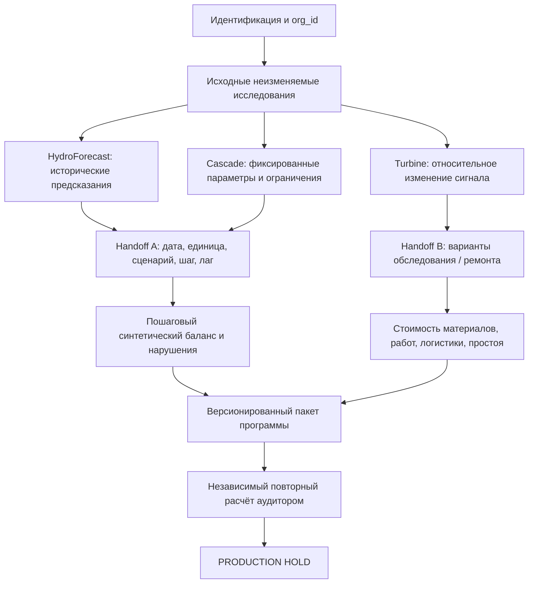

# ГИДРОКОНТУР 360 — МАГАДАН: архитектурный контракт V7.5

**Версия:** V7.5-LAB · **дата:** 23.10.2026 · **назначение:** внутренние исследования и подготовка инженерного ТЗ. **Статус:** PRODUCTION HOLD. Нет лицензированных производственных данных, независимой экспертизы реального оборудования, подтверждённого экономического результата либо права выполнять команды промышленному оборудованию.

## 1. Продуктовая и предметная модель

Главный объект системы — воспроизводимый маршрут «правообладатель данных → подтверждённая запись → допустимая модель → расчёт с версиями → техническая интерпретация → сравнение альтернатив → финансовый расчёт → ответственное решение → постпроектная оценка». Отсутствующее звено блокирует продвижение результата в следующий уровень статуса; научное исследование не повышается до инвестиционного решения переключением роли на экране.

Шесть продуктов образуют разные bounded contexts:

| Контекст | Ответственность | Не должен делать |
|---|---|---|
| HydroForecast | Гидрологические наблюдения, модели, качество, прогнозный ансамбль | Изменять водный режим самостоятельно |
| CascadeEconomics | Водный баланс, технические ограничения, допустимые сценарии | Автоматически управлять затворами/агрегатами |
| TurbineReliability | Диагностические отклонения, дефекты, экспертные задачи | Объявлять вероятность отказа без калибровки |
| GridLoss Planner | Электрическая модель, потери, инженерные альтернативы | Замыкать/размыкать сеть и менять РЗА |
| HeatNet Economics | Гидравлика, тепловые балансы, варианты модернизации | Самостоятельно задавать режим реальной теплосети |
| HydroCAPEX | Инженерные основания, финансовые альтернативы, бюджет, WBS, аудит | Подменять полномочия инвесткомитета или сметную экспертизу |

## 2. Архитектурное развитие относительно V7.4

До V7.5 существовали пять **семантических** связей. Семантическая связь означает только заявленное отношение двух исследований. Для двух направлений в V7.5 введён дополнительный строгий **численный контракт**, результаты которого хранятся отдельно от родительского пакета:

На V7.5 это две разные физико-экономические связи. **Энергия из моделирования каскада не превращается в доход без учёта режима рынка, водных ограничений и согласованной методики.** **Стоимость технического ремонта не является предотвращённым ущербом**, если неизвестна вероятность события и влияние вмешательства. Численная интеграция до промышленного права на применение ещё далеко не завершена.

## 3. Контракт «HydroForecast → Cascade»

**Исходный объект:** сохранённый расчёт типа `hydroforecast` с временной меткой выпуска `issued_at`, историями наблюдений и точками прогноза. Источник в V7.5 всегда синтетический, оценочный тип `HINDCAST_ONLY`: это исторический прогноз, а не актуальное предсказание водности.

**Источник второго типа:** расчёт `cascade` с двумя резервуарами, подтверждаемой в будущей работе структурой ограничений, начальным объёмом, расходами воды, условным напором, КПД, ограничением по мощности и выпуску.

**Численный контракт:**
- `kind = HISTORICAL_PREDICTION_TO_UPPER_LOCAL_INFLOW`; физическая величина расхода воды в м³/с; не объём в м³ и не высота уровня воды в метрах;
- `scenario = point | lower | upper`; выбор *одного* сценарного ряда; три ряда не объявляются автоматически вероятностным распределением;
- `issued_at` и `target_at`: временные метки с часовым поясом, внутри результаты нормализуются в UTC;
- `step_hours` — шаг в часах, строго одинаковый для сценария и расчётного шаблона каскада;
- интервалы времени непрерывны, дубли недопустимы; число шагов ограничено 72;
- `travel_lag_steps` задаёт только упрощённую целочисленную задержку; предыдущие выпуски вводятся явно через `arrival_history_cms`;
- `hydrological_mapping_ref` отмечает применённую синтетическую гипотезу сопоставления водосбора и верхнего резервуара;
- `actual_cms` не участвует в подаче чисел гидравлической модели, даже если имеется в исторической базе для оценки точности.

**Упрощённый водный баланс:**

\[V_{t+1}=V_t+\left(Q_{in,t}-Q_{turbine,t}-Q_{spill,t}-Q_{other,t}\right)\Delta t\]

Здесь `Q` в м³/с, `Δt` в секундах, результат в м³. Для второй ступени поступление включает лагированный выпуск верхней ступени и явно заданный локальный приток нижнего участка. **Не реализованы** маршрутизация волны, кривые объём–уровень–напор, переменный КПД и паспортные характеристики Колымской и Усть-Среднеканской ГЭС.

**Синтетическая электрическая мощность:**

\[P_{MW}=0{,}00981\,Q_{turbine}\,H\,\eta\]

Проверяются верхняя и нижняя границы объёма, минимальный заданный выпуск и предельная мощность. Нарушение остаётся в отчёте (`LAB_CONSTRAINT_BREACH`); приложение не «лечит» нарушение скрытой корректировкой расходов.

**Почему это важно:** пользователь должен увидеть не просто график притока, а технически совместимое описание временного сценария и последствия передачи именно прогнозного расхода в модель допустимого состояния каскада. Но без гидрологических правил и независимой экспертизы это ещё не допустимая программа работы ГЭС.

## 4. Контракт «TurbineReliability → техническое мероприятие»

**Источник:** диагностическое исследование с меткой времени, режимом нагрузки, измеренными значениями вибрации, медианой базового периода и статистическим отклонением. Диагностический индекс не является доказанным дефектом.

**Допустимое действие в лаборатории:** инженер создаёт несколько явно названных гипотетических альтернатив (`inspection`, `repair`, `replacement`, `defer`), для каждой указывает материалы, работы, стоимость северной логистики, часы условной недоступности, принятую денежную оценку одного часа, срок поставки и синтетический источник предпосылок.

**Прозрачный расчёт:**

\[C_{direct}=C_{materials}+C_{labor}+C_{north\,logistics}\]

\[C_{assumed\,downtime}=H_{outage}\times C_{hour}\]

\[C_{lab\,scenario}=C_{direct}+C_{assumed\,downtime}\]

**Важно:** `C_hour` вводится как предположение для проверки алгоритма; оно не отражает подтверждённую цену недоотпуска электроэнергии. Результат намеренно не содержит рекомендованного к исполнению варианта и не вычисляет вероятность или ожидаемый предотвращённый ущерб. Вариант `defer` не означает, что вероятность аварии или последствия равны нулю.

**Следующие обязательные источники:** паспорт агрегата, эксплуатационные и дефектные журналы, акты, подтверждённые сроки поставки, независимая инженерная интерпретация, согласованные ремонтные окна и финансовая методика.

## 5. Данные и безопасность: индивидуальный контекст организации

**Хранимые таблицы:** `study_runs`, `research_programmes`, `research_programme_studies`, `research_handoffs`, `audit_events`. Для `research_handoffs` есть две составные ссылки `(org_id,left_study_id)` и `(org_id,right_study_id)`, отдельная связь с исследовательской программой `(org_id,programme_id)`, SHA-256 исходных данных и результатов, SHA-256 исходного кода адаптера.

**Вызовы HTTP:**
- `POST /v75/orgs/{org_id}/handoffs` — создать новый исследовательский handoff; только роль engineer, действует серверная проверка организации;
- `GET /v75/orgs/{org_id}/handoffs` — ограниченный список в рамках организации;
- `GET /v75/orgs/{org_id}/handoffs/{id}` — текущее неизменяемое досье, проверка SHA;
- `POST /v75/orgs/{org_id}/handoffs/{id}/reproduce` — повторный физический/стоимостной расчёт по закреплённой версии;
- `GET /v75/orgs/{org_id}/programmes/{id}/handoffs` — список связанных досье и открытых промышленных допусков;
- `POST /v75/orgs/{org_id}/programmes/{id}/reproduce-handoffs` — повторить дочерние вычисления, не подменяя полную проверку родительского пакета;
- `POST /v74/orgs/{org_id}/programmes/{id}/reproduce` — существующая независимая от нового пакета проверка родительских расчётов.

**Защита от неверных состояний:** отсутствующий источниковый расчёт другой организации возвращает 404; неправильная роль 403; несоответствие структуры входа 422; дубли, неверные межобъектные ссылки и подмены сохранённых результатов 409. Автоматической связи с таблицей официальных инвестиционных решений нет.

**PG-миграция 090:** включает FORCE RLS, раздельные роли, запрет UPDATE/DELETE, автоматический аудит, проверку двух исследовательских классов и ссылок на программу. SQL подготовлен, но PostgreSQL в текущей среде отсутствует, **нативная RLS не принята**.

## 6. Уровни подтверждения и запреты

| Уровень | Допустимое утверждение | Статус V7.5 |
|---|---|---|
| Calculated | Алгоритм вернул конечное синтетическое значение | Есть |
| Reproduced | Тот же ввод и версия кода дают тот же результат | Есть |
| Tenant API checked | Роль и компания проверяются сервером в SQLite лаборатории | Есть |
| Native RLS accepted | PostgreSQL транзакции, FORCE RLS, конкуренция и миграции реально исполнены | Нет |
| Independent engineering accepted | Внешний расчёт на согласованной контрольной модели | Нет |
| Field data authorized | Правообладатель предоставил данные и границы объекта | Нет |
| Industrial investment approved | Соблюдены полномочия, право, техрегулирование, экономика, аудит | Нет |

Никакие графики, суммы WBS, число тестов или наличие модели не заменяют независимый инженерный допуск. Нельзя подключать реальные АСУ ТП/РЗА/затворы, обходить технологические контуры и отправлять команды оборудованию.

## 7. Дальнейшее развитие V7.6–V8

**P0:** завершить PostgreSQL 17 нативную приёмку 001–090 и конкурентные транзакции; получить отдельную внешнюю аудиторскую среду, IdP с MFA; блокировать любой необоснованный доступ к чувствительной информации.

**P0:** стандартизировать для магаданского пилота идентификаторы объектов, версионирование топологии, единицы, интервалы измерений, метрологические статусы и правообладание. Определить внешнего расчётного эксперта с документированными порогами допуска.

**P1:** заменить фиксированную задержку и постоянный напор гидрологически и гидравлически подтверждёнными функциями. Передавать вероятностные сценарии с калиброванной неопределённостью; нельзя считать «нижнюю–верхнюю» границу доверительным интервалом без его статистического основания.

**P1:** сформировать связанные ремонтные альтернативы, WBS/CBS, договорные заявки и ведомости стоимости; отдельно классифицировать CAPEX/OPEX, не считать каждый ремонт капитальным строительством. Финансовый аудитор должен подтвердить правила отражения затрат.

**P1:** объединить сетевые и тепловые мероприятия в неизбыточный реестр выгод, с независимой оценкой эффекта относительно контрфактического состояния и изменяющихся условий.

**P2:** цифровые строительные досье CAD/BIM, фактические разрешения, модели логистики Колымы и внешние отраслевые интеграции после получения законных прав и проверки надёжности.

## 8. Проверяемые нормативно-технические источники

- PostgreSQL 17 Row Level Security: https://www.postgresql.org/docs/17/ddl-rowsecurity.html (FORCE, DEFAULT DENY, owner/bypass, особенности REFERENCES).
- PostgreSQL 17 безопасный `SECURITY DEFINER`: https://www.postgresql.org/docs/17/sql-createfunction.html (ограничение `search_path` и прав).
- CF Conventions для гидрометеорологических метаданных: https://cfconventions.org/cf-conventions/cf-conventions.html (единицы, имена физических величин и координаты времени).
- HEC-ResSim (ориентир на полноценный инженерный режим водохранилища): https://www.hec.usace.army.mil/software/hec-ressim/features.aspx.

**Публичные нормы — основания для проектной методологии, а не документ об инженерной или промышленной приёмке ГИДРОКОНТУР 360.**
