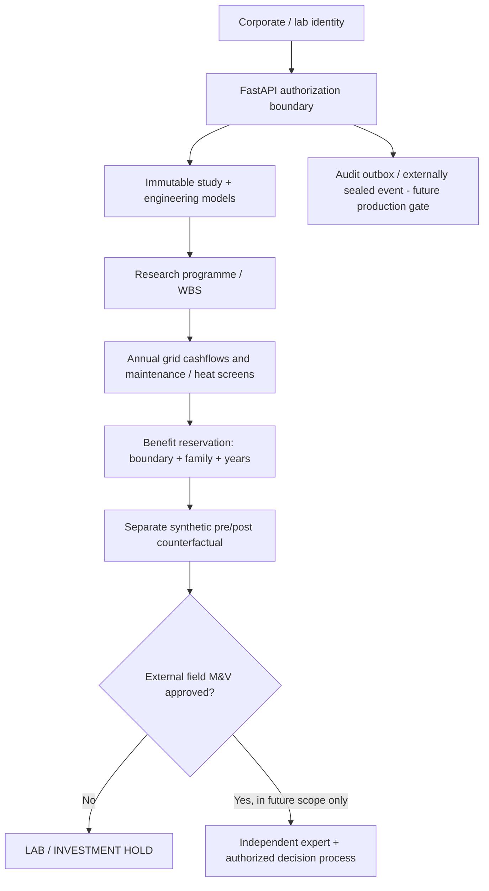

# HYDROKONTUR 360 / MAGADAN - V7.9 architecture and evidence boundaries

**Classification:** LABORATORY. Synthetic data only. No industrial authorization, SCADA control, construction permit, grant award, actual savings, or cooperation agreement with RusHydro.

## 1. What changed in V7.9

V7.8 had mechanically sound module-local duplication checks, but no authoritative across-module benefit ownership. V7.9 adds two append-only components:

- **BenefitReservationV79:** entity-owned asset boundary + benefit family + inclusive reporting-year interval + immutable source/version + synthetic M&V plan. The API refuses overlapping periods for the same organization/asset/family, even if source identifiers and descriptive titles differ. A second reservation of the same source is blocked. This is a reservation, not a claimed saving.
- **MeasurementScreenV79:** synthetic pre/post counterfactual model. Pre-commissioning data alone calibrate the loss-vs-load/temperature model. A chronological baseline holdout checks errors. Post-period observations are used for evaluation, never model fitting. Inferences are not independently attested or legally recognized.

These additions **do not retroactively reconcile legacy financial dossiers**. Until migration/backfill and independent source attribution are completed, totals across historical V7.3, V7.6 and V7.8 reports must NOT be added to V7.9 reservations.

## 2. Domain boundaries

A *real* effect must not be recognized by moving a lab flag to `true`. A future separate, authenticated field-validation workflow and new data entities are needed. Existing API has no command to do so.

## 3. Explicit trust boundaries

1. **Identity:** lab JWT roles validated per request; OIDC adapter requires separately connected IdP, policy and MFA. Role names from client inputs are not trusted.
2. **Tenant:** all new queries filter by authenticated organization; the asset must belong to the organization and be classified `LAB_REFERENCE`.
3. **Source:** benefit reservations refer only to approved *types* of existing synthetic records. Grid annual records must have valid source hashes, while maintenance handoffs re-run the original turbine study and the resulting maintenance calculation.
4. **Calculation:** hash checks and re-computation do not mean independent engineering attestation.
5. **Finance:** synthetic gross avoided cost is distinct from NPV, tariff revenue, booked P&L or realized cashflow.
6. **Decision:** no path from BenefitReservationV79 or MeasurementScreenV79 into V7 production initiative transitions; even V7 approved-state UI is not a valid authorization for field construction.
7. **Audit:** the current SQLite HMAC chain is tamper-evident against accidental changes but not WORM against privileged local operators. Native PostgreSQL security and an external signed archive remain P0 blockers.

## 4. Benefit recognition and reservation data model

| Field | Why it exists | Rule |
| --- | --- | --- |
| org_id | Accountable organization | Membership verified on server |
| asset_id | Physical measurement boundary | Existing `assets` row from same org; lab only |
| family | Economic mechanism | Closed enum; renaming title does not change identity |
| start_year/end_year | Reporting period | Inclusive; overlapping same boundary/family forbidden |
| source_kind/source_id | Traceable calculation | Existing verifiable record, no arbitrary URLs as an authority |
| source_sha256 | Exact result version | Rechecked at read and reproduce |
| measurement_plan_ref | Planned M&V basis | Explicit SYNTHETIC marker |
| comparison_normalization | Baseline adjustment hypothesis | Required text; not an independent signed plan |
| lab_estimated_gross_rub | Optional model output | Never a recognized value or a sum of corporate savings |
| reservation_sha256 | Fixed assertion hash | Read-time tampering detection |

The SQLite `BEFORE INSERT` overlap trigger rejects concurrent colliding registrations under the SQLite writer lock; two concurrent HTTP creation attempts are tested to produce one 201 and one 409. PostgreSQL 17 candidate migration 130 uses `btree_gist` and `EXCLUDE USING gist` over tenant, asset, family and an inclusive-years `int4range`. Its actual concurrent transaction behavior is NOT VERIFIED.

Inclusion of multiple separate measures in the same boundary requires a **separate independently justified allocation method**. V7.9 fails closed and rejects overlaps rather than inventing allocation percentages. Claims sharing underlying upstream physical benefit across different assets still require a future boundary graph and conflict reconciliation.

## 5. Actual code and files

- `server/hydro_api/benefit_ledger_v79.py` - type/period domain and gross-value sourcing.
- `server/hydro_api/benefit_api_v79.py` - authenticated immutable API with replay and source gates.
- `server/hydro_api/measurement_v79.py` - chronological OLS modeling and validity gates.
- `server/hydro_api/measurement_api_v79.py` - persisted synthetic M&V screen and audit role replay.
- `server/hydro_api/storage.py` - local table models, append-only triggers, atomic overlap lock.
- `server/migrations/130_benefit_ledger_v79.sql`, `140_measurement_screen_v79.sql` - native PostgreSQL SQL candidates only.
- `server/tests_v79` - positive/negative/HTTP/concurrent tests.
- `server/ui/index.html`, `server/ui/ui.js` - 13th workspace, new server-backed controls. Static syntax/element checks pass; graphical and live browser QA not accepted in this environment.

## 6. Platform-wide corrective program

### P0 before corporate pilot

- Dedicated PostgreSQL 17: migration 001-140 on EMPTY test DB, RLS and grants tested as `hk_app`, independent DBA review, concurrency, backup/recovery.
- Independent IdP and MFA, staff join/leave/revoke tests, session expiry and CSRF boundary.
- External signed and retention-enforced audit archive with version-specific receipt verification and restore test.
- Backfill and cross-module ledger enforcement: existing dossiers cannot bypass the benefit ledger at source-creation or official aggregation.
- Independently operated AC reference solver (pandapower/OpenDSS/RastrWin) with executable build/version evidence, matching electrical conventions, nodal voltages and line losses.

### P1 before real Magadan object calculations

- Owner-signed scope and permitted historical extract for a selected feeder; asset identifiers, topology revision, device nameplates, meter traceability, data periods, actual operating restrictions.
- Engineering validation: calibrated network model, seasonal load windows and uncertainty, stress conditions, multi-period comparisons and peer-reviewed tolerances.
- Financial validation: actual avoided-cost methodology, regulated treatment, VAT/profit tax, nominal vs real prices, tariff/rate constraints and independent review.
- Construction validation: engineering surveys, owner-approved WBS/CBS, approvals matrix, verified bill of quantities, equipment lead times, commissioning evidence, as-built records and post-project M&V baseline.

## 7. Status terminology

`LAB_IMPLEMENTED` = code exists, tested on synthetic data.
`SQL_CANDIDATE` = migration designed but not applied.
`EXTERNAL_HOLD` = field evidence/IdP/WORM/independent engineering unavailable.
`PRODUCTION_HOLD` = no authorization for real energy operations, actual savings or investment.

## Authoritative methodological references

- PostgreSQL 17 RLS and bypass rules: https://www.postgresql.org/docs/17/ddl-rowsecurity.html
- PostgreSQL exclusion constraints: https://www.postgresql.org/docs/17/ddl-constraints.html
- EVO IPMVP general measurement and verification framework: https://evo-world.org/en/products-services-mainmenu-en/protocols/ipmvp
- pandapower AC power flow documentation: https://pandapower.readthedocs.io/en/stable/powerflow.html
